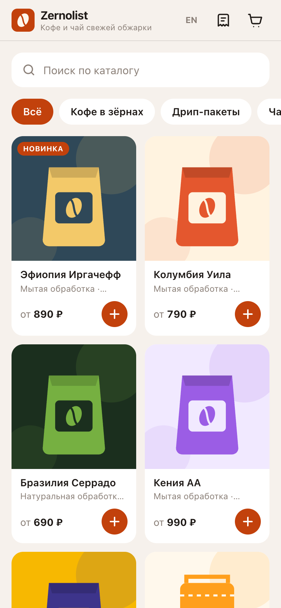
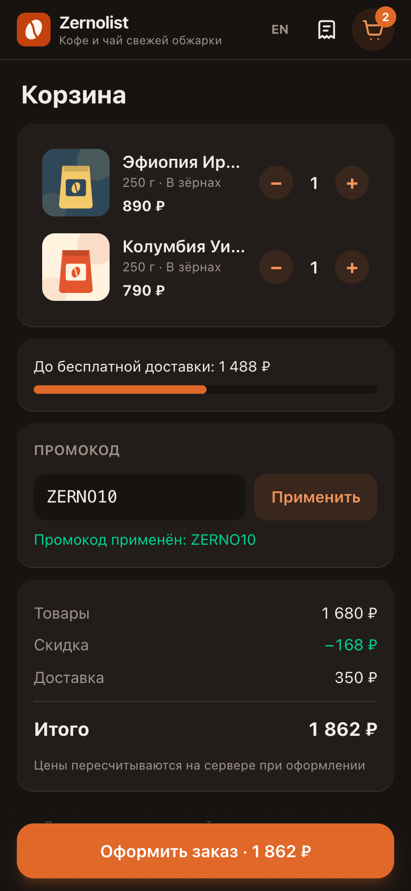
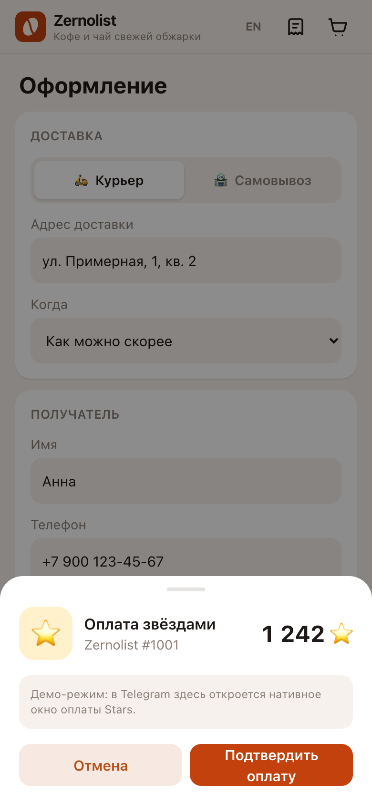
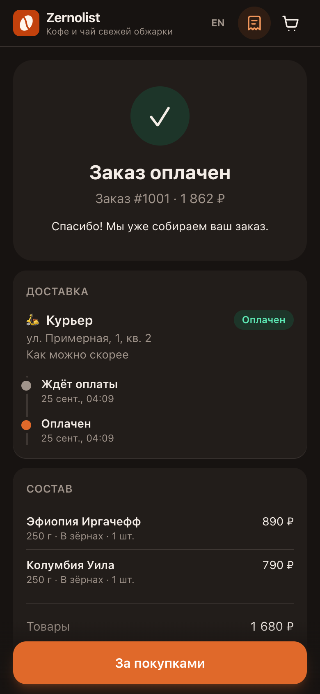
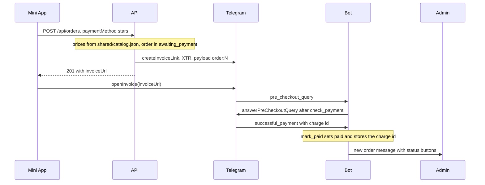

# Zernolist — a Telegram Mini App shop

**English** · [Русский](README.ru.md)

<p>
  
  
  
  
</p>

A coffee and tea shop that opens inside Telegram: a React Mini App, an aiogram 3 bot and a FastAPI backend in one Python process, orders in SQLite, payment in Telegram Stars or on receipt. The admin gets orders in the bot and changes their status with buttons under the notification. Zernolist does not exist: I made up the products, prices and pickup points, and nobody ordered this shop from me.

Demo in a regular browser: https://sinnercode228.github.io/tg-shop-miniapp/. It has no backend: [`MockShopApi`](webapp/src/api/mock.ts) applies the same pricing and status rules in the browser, keeps orders in `localStorage` and moves them on 30 seconds, 3 minutes and 15 minutes after checkout (for a Stars order, after payment). A Stars order left unpaid for 30 minutes is cancelled, as the bot does by default. A browser has no Telegram main button or Stars sheet, so the page draws `FallbackMainButton` and `DemoInvoiceSheet` ([`Chrome.tsx`](webapp/src/components/Chrome.tsx)). The screenshots were taken in this mode, not in a Telegram client. Inside Telegram, [`telegram/sdk.ts`](webapp/src/telegram/sdk.ts) copies `themeParams` into the `--tg-*` CSS variables behind the Tailwind tokens and rewrites them on `themeChanged`.

## How a Stars order moves through the Mini App, API and bot

In the default `--mode all` the API and the bot are one process with one shared `OrderService`. The diagram draws them apart because the Mini App reaches the API over HTTP, while Telegram reaches the bot through updates.



Write-up on the whole path and on why a redelivered `successful_payment` does not mark an order paid twice: [How Zernolist prices an order on the server and accepts each Telegram Stars charge once](https://github.com/sinnercode228/sinnercode228/blob/main/notes/zernolist-stars-payments.md).

## What the server never trusts

The client sends cart lines as `productId`, `variantId`, `grind` and `quantity` ([`domain/schemas.py`](bot/tgshop/domain/schemas.py)). There is no price field, and extra fields are dropped. `OrderService._resolve` ([`services/orders.py`](bot/tgshop/services/orders.py)) takes the product, variant and price from [`shared/catalog.json`](shared/catalog.json) and merges duplicate lines. `test_client_supplied_prices_are_ignored` ([`test_api.py`](bot/tests/test_api.py)) posts a gaiwan with `"price": 1` and `total: 1` and checks that the order's `subtotal` is the catalog's 129000 kopecks.

Money is integer kopecks from [`shared/pricing.json`](shared/pricing.json) to the database columns. In [`domain/pricing.py`](bot/tgshop/domain/pricing.py):

- a percent discount rounds down to a whole rouble: `ZERNO10` on 1503.45 ₽ gives 150 ₽, not 150.345, and is capped at 1000 ₽;
- courier delivery is 350 ₽, free from 3000 ₽ counted after the discount, or with `FREEDELIVERY`;
- one Star is 150 kopecks, rounded up without floats: `-(-amount // rules.kopecks_per_star)`. The screenshots show a 1862 ₽ cart and a 1242-Star sheet: 186200 / 150 = 1241.33, rounded up;
- an unknown promo code is a `promoError` on `POST /api/quote` and a 422 `unknown_promo` on `POST /api/orders`.

[`webapp/src/domain/pricing.ts`](webapp/src/domain/pricing.ts) repeats these rules for the cart and the demo API; in `http` mode the checkout screen shows the server's numbers from `POST /api/quote`. The 9 vectors in [`shared/pricing-cases.json`](shared/pricing-cases.json) run in both pytest ([`test_pricing.py`](bot/tests/test_pricing.py)) and vitest ([`pricing.contract.test.ts`](webapp/src/domain/pricing.contract.test.ts)), so both implementations are checked against the same expected numbers.

Order endpoints require `Authorization: tma <initData>` ([`api/deps.py`](bot/tgshop/api/deps.py)); `/api/catalog`, `/api/quote` and `/api/health` are public. [`security/init_data.py`](bot/tgshop/security/init_data.py) follows the Telegram docs: `secret = HMAC_SHA256("WebAppData", bot_token)`, then an HMAC of the sorted `key=value` pairs without `hash`, compared with `hmac.compare_digest`. initData is also rejected when:

- a key appears twice (checked before the signature);
- `auth_date` is more than 60 s in the future, or older than `INIT_DATA_TTL` (24 h by default; the setting does not accept less than 60 s);
- `user` is missing or malformed, even under a valid signature.

`test_algorithm_matches_telegram_docs_step_by_step` ([`test_init_data.py`](bot/tests/test_init_data.py)) derives the hash with `hmac` and `hashlib` directly, then compares `compute_hash` with it. The Bot API 8.0 `signature` field stays in the check string; only `hash` is excluded. The Ed25519 signature itself is not verified, only the HMAC.

Someone else's order returns the same 404 `not_found` as a missing one (`get_for_user`), so order ids cannot be probed.

## Stars payment, step by step

1. `POST /api/orders` with `paymentMethod: "stars"` creates the order in `awaiting_payment` with a fixed `stars_amount`, calls `createInvoiceLink` (currency `XTR`, payload `order:<id>`, no provider token; [`payments/stars.py`](bot/tgshop/payments/stars.py)) and returns `invoiceUrl` in the same response.
2. The Mini App opens it with `Telegram.WebApp.openInvoice` ([`api/http.ts`](webapp/src/api/http.ts)). If the sheet is closed, the order page keeps a pay button that gets a fresh link from `POST /api/orders/{id}/invoice` ([`routes/orders.py`](bot/tgshop/api/routes/orders.py)) while the order still awaits payment.
3. Telegram sends `pre_checkout_query`, and the bot has 10 s to answer. `check_payment` checks the payload, the currency, that the payer owns the order, that it still awaits payment and that the amount equals `stars_amount`.
4. On `successful_payment`, `mark_paid` repeats that check, stores `telegram_payment_charge_id` (refunds need it) and sets `paid`. Admins get the new-order message for a Stars order only now; pay-on-receipt orders reach them at once.
5. A redelivered update whose charge id is already on the order returns early. `test_full_stars_payment_flow` ([`test_order_service.py`](bot/tests/test_order_service.py)) calls `mark_paid` twice and checks that admins are notified once. aiogram handles each update as its own task, so two updates for one order can also arrive at the same time. `with_for_update()` does not help there on SQLite, where it compiles to a plain `SELECT`, so `mark_paid` sets `paid` with a conditional `UPDATE ... WHERE status = 'awaiting_payment'` (`claim_payment` in [`db/repository.py`](bot/tgshop/db/repository.py)) and only one of the two matches the row. The other one reads the order again: with the same charge id it returns the order, with a different one it refunds that charge as in step 6. `test_concurrent_updates_for_one_charge_record_it_once` and `test_concurrent_payments_with_different_charges_refund_one` run two calls at once against a SQLite file.
6. If the order cannot take the money (cancelled while the sheet was open, amount out of date), `mark_paid` records a refund of that charge (step 9) and the bot does not reply to the payment. Once the Stars are back, the customer gets «Платёж не принят (…). Звёзды возвращены.» (payment not accepted, Stars returned). Covered by `test_payment_for_cancelled_order_is_refunded_automatically`. The admin's cancel and the payment can also meet halfway: `change_status` writes with the same conditional `UPDATE` (`move_status`), so a cancel whose order got paid after it read it is refused and the order stays `paid`, and a payment whose order got cancelled after it read it is refunded. `test_payment_between_cancel_read_and_write_keeps_the_order_paid` and `test_cancel_between_payment_read_and_write_refunds_the_payment` cover both orders of events.
7. A Stars order still in `awaiting_payment` 30 minutes after it was placed is cancelled by the bot process (`--mode all` or `--mode bot`; `--mode api` does not do it): [`UnpaidOrderExpiry`](bot/tgshop/services/expiry.py) checks when polling starts and then once a minute. `ORDER_PAYMENT_TTL_MINUTES` sets the time, and 0 turns the expiry off. It writes with the same conditional `UPDATE` (`move_status`), so a payment that arrives at the same moment either gets there first, and the order stays `paid`, or finds the order cancelled and is refunded as in step 6. The customer gets the same status message as after a manual cancel, and admins get the order card titled «Заказ не оплачен вовремя» (not paid in time). `test_payment_between_expiry_read_and_write_keeps_the_order_paid` and `test_expiry_between_payment_read_and_write_refunds_the_payment` ([`test_expiry.py`](bot/tests/test_expiry.py)) cover both orders of events, and `test_payment_for_an_expired_order_is_refunded` a payment that comes later.
8. Later refunds: `/refund <id>` or the admin's inline button set `refunded` and record the refund in one transaction. The customer gets the status message once the Stars are back (step 9). A second refund of the same order that read it before the first one wrote is refused: `refund` writes with the same conditional `UPDATE` (`test_refund_between_another_refunds_read_and_write_is_refused`).
9. Refunds go through an outbox. Each refund the shop owes is a row in `refunds` ([`db/models.py`](bot/tgshop/db/models.py)) with the charge id (one row per charge), the user id, the amount in Stars, the status `pending`, `done` or `failed`, the attempt count, `next_attempt_at` and the last error. It is written in the same transaction as the order change, so if that commit fails, neither of them is there (`test_refund_is_recorded_with_the_status_change_or_not_at_all`). [`RefundOutbox`](bot/tgshop/services/refunds.py) runs in the bot process, like the expiry, and calls `refundStarPayment` outside any transaction: right after a refund is recorded, when polling starts and then every 10 seconds. A failed call is tried again `REFUND_RETRY_SECONDS` later (30 by default), and each next wait is twice as long. After `REFUND_MAX_ATTEMPTS` attempts (8 by default, the last one about an hour after the first) the refund is `failed`, and admins get a message with the order, the charge id and the last error. A redelivered `successful_payment` finds its charge id in `refunds` and adds nothing (`INSERT ... ON CONFLICT DO NOTHING`). A `CHARGE_ALREADY_REFUNDED` answer, which comes when an earlier call went through but its answer was lost, counts as done. The tests are in [`test_refunds.py`](bot/tests/test_refunds.py).

I register the payments router first ([`bot/factory.py`](bot/tgshop/bot/factory.py)). No other router handles `pre_checkout_query` today; registering it first keeps one added later from taking the query. [`TelegramNotifier`](bot/tgshop/bot/notifier.py) logs a `TelegramAPIError` instead of raising it, so a blocked bot loses the notification, not the order.

Statuses are an explicit graph in [`domain/status.py`](bot/tgshop/domain/status.py); `ensure_transition` rejects every other move. The diagram follows the module docstring:

```text
awaiting_payment ──► paid ──► confirmed ──► in_delivery ──────► completed
      │                │          │    └──► ready_for_pickup ─► completed
      ▼                ▼          ▼
  cancelled        refunded   cancelled / refunded
new ──► confirmed …          (pay on receipt, no payment step)
```

`allowed_transitions` also looks at the payment method: a paid Stars order can be refunded but not cancelled, a pay-on-receipt order cannot be refunded, and `paid` is never set by hand. The admin's buttons are built from it ([`keyboards.py`](bot/tgshop/bot/keyboards.py)). Each change goes to `order_events`, which the Mini App draws as the timeline; SQLite drops `tzinfo` on read, so every `datetime` column goes through the `UTCDateTime` type ([`db/models.py`](bot/tgshop/db/models.py)).

## Run

The Mini App in [`webapp/`](webapp) uses React 19, Vite, TypeScript, Tailwind CSS 4 and zustand. In [`bot/`](bot), aiogram 3 and FastAPI share one process with SQLAlchemy 2 (async) and aiosqlite. Both sides read the catalog and pricing rules from [`shared/`](shared). Each block starts from the repository root.

```bash
# Mini App on mock data, as on GitHub Pages (Node 22)
cd webapp && npm ci && npm run dev        # http://localhost:5173
```

```bash
# API (Python 3.12+)
cd bot
python3 -m venv .venv && source .venv/bin/activate
pip install -e ".[dev]"
cp .env.example .env
python -m tgshop --mode api               # :8080, OpenAPI at /api/docs
```

```bash
# Mini App against that API; Vite proxies /api to :8080
cd webapp && VITE_API_MODE=http npm run dev
```

`--mode api` runs with the example `.env` as is. `--mode all` (the default, bot and API) and `--mode bot` set the bot's commands and menu button on startup, so they need a real `BOT_TOKEN` from @BotFather; with the placeholder token they exit with `TelegramUnauthorizedError`. Admin user ids go into `ADMIN_IDS`; the other variables are listed in [`bot/.env.example`](bot/.env.example).

In a browser, `http` mode can load `/api/catalog` and `/api/quote`, but orders get a 401 without initData, so placing one needs the Telegram client. `WEBAPP_URL` defaults to the GitHub Pages demo, which runs on mock data and never calls your API; point it at an HTTPS address that serves an `http` build.

Docker: `cp bot/.env.example bot/.env`, set `BOT_TOKEN`, then `docker compose up --build`. The API listens on `:8080`; nginx serves the Mini App, built with `VITE_API_MODE=http`, on `:8081` and proxies `/api`. Telegram opens Mini Apps over HTTPS only, so put a tunnel or reverse proxy in front of `:8081` and its URL into `WEBAPP_URL`.

Checks, the same as in [CI](.github/workflows/ci.yml) (Python 3.12 and 3.14, Node 22):

```bash
(cd bot && pytest --cov && ruff check . && ruff format --check . && mypy)          # 142 tests, 95 % coverage
(cd webapp && npm run lint && npx prettier --check . && npm test && npm run build)  # 42 vitest tests
```

[`tests/test_bot.py`](bot/tests/test_bot.py) runs the bot handlers without aiogram mocks: real `Update` objects go through a real `Dispatcher` with routing, filters and DI, and a `RecordingSession` records each Bot API call in place of the network. vitest covers the cart, search, money formatting, the demo API, the 9 pricing vectors and four UI scenarios in jsdom.

## Known limitations

- An admin's refund sets `refunded` when it is recorded, before the Stars are back. A refund that ends `failed` stays that way: admins get its charge id, but no command tries it again ([`services/refunds.py`](bot/tgshop/services/refunds.py)).
- The `postgres` extra is declared in [`pyproject.toml`](bot/pyproject.toml), but no test or CI job runs against Postgres.
- After `openInvoice` the order page reloads once ([`OrderPage.tsx:35`](webapp/src/pages/OrderPage.tsx#L35)). In `http` mode the order turns `paid` only after the bot reads `successful_payment` over long polling, so that reload can still show `awaiting_payment`. There is no polling.
- `openInvoice` can report `pending`; [`CheckoutPage.tsx:134`](webapp/src/pages/CheckoutPage.tsx#L134) and [`OrderPage.tsx:33`](webapp/src/pages/OrderPage.tsx#L33) treat anything but `paid` as cancelled.
- The Mini App does not know about the payment time limit. After the payment sheet is closed, the order page says the order can be paid later from the order history ([`OrderPage.tsx:111`](webapp/src/pages/OrderPage.tsx#L111)) and shows no deadline.
- The bot accepts orders as `web_app_data` ([`handlers/webapp.py`](bot/tgshop/bot/handlers/webapp.py)), and `/start` sends the reply-keyboard button that launch mode needs ([`handlers/common.py:16`](bot/tgshop/bot/handlers/common.py#L16)), but the Mini App never calls `sendData`: [`telegram/sdk.ts:69`](webapp/src/telegram/sdk.ts#L69) only declares it.
- The schema comes from `create_all` at startup ([`db/session.py:34`](bot/tgshop/db/session.py#L34)); there are no migrations.
- [`handlers/admin.py`](bot/tgshop/bot/handlers/admin.py) is at 73 % test coverage.
- The demo API saves item titles and variant labels in Russian ([`api/mock.ts:162`](webapp/src/api/mock.ts#L162)); in English mode the order list ([`OrdersPage.tsx:68`](webapp/src/pages/OrdersPage.tsx#L68)) and the variant label on the order page ([`OrderPage.tsx:161`](webapp/src/pages/OrderPage.tsx#L161)) still show them in Russian.
- The phone regex is written three times: [`domain/schemas.py:15`](bot/tgshop/domain/schemas.py#L15), [`api/mock.ts:22`](webapp/src/api/mock.ts#L22), [`pages/CheckoutPage.tsx:15`](webapp/src/pages/CheckoutPage.tsx#L15).

---

Built by Грешный Котик (sinnercode). I take freelance work like this: Telegram [@sinnercode](https://t.me/sinnercode). License: [MIT](LICENSE).
